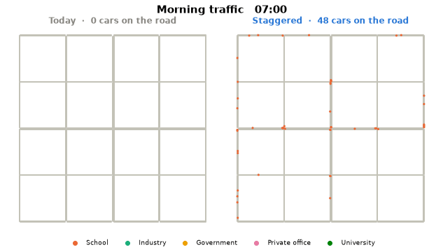

# 🚦 ReTimeSim — What if the whole city didn't start work at the same time?

**[▶ Open the live app: retimesim.streamlit.app](https://retimesim.streamlit.app/)** · a Python × SUMO traffic simulation dashboard



*Morning traffic, 07:00–10:30. Each dot is a car, coloured by where its driver is going. Left: today's schedule. Right: staggered start times.*

Schools, industries, offices and universities send thousands of commuters onto the same roads at 8 and 9 o'clock. In **ReTimeSim** you choose a new start time for each institution with a slider. The app then simulates all 10,000 car trips of the day in [SUMO](https://eclipse.dev/sumo/), a microscopic traffic simulator, and shows what happens to rush hour.

## Using the app

1. **Overview**: the sample city and today's schedule.
2. **Choose start times**: one institution at a time, each with its own slider. Working hours stay the same, so the end time moves with the start.
3. **Review & submit**: check every change. Nothing runs until you press **Submit and run**.
4. **Simulation**: the app reports each step as it happens and shows the simulated clock with the number of cars on the road.
5. **Results**:
   - KPI cards with the change against today's schedule
   - a side-by-side traffic replay, plus a slider to inspect any single moment
   - traffic over the day, departure times and delay by group
   - all indicators in one table
   - on a computer with SUMO installed, a button to watch the run live in **SUMO-GUI**

## Example result

| Group | Today | Staggered example |
|---|---|---|
| 🏫 School | 09:00–16:00 | 07:30–14:30 |
| 🏭 Industry | 08:00–17:00 | 08:00–17:00 |
| 🏛️ Government | 09:00–17:00 | 09:00–17:00 |
| 🏢 Private office | 09:00–17:00 | 10:00–18:00 |
| 🎓 University | 08:00–17:00 | 10:00–19:00 |

| Indicator | Today | Staggered | Change |
|---|---|---|---|
| Average travel time | 9.4 min | 6.7 min | −28% |
| Average delay per trip | 6.2 min | 3.7 min | −40% |
| Peak cars on the road | 1,424 | 821 | −42% |
| Total delay per day | 1,032 veh-h | 616 veh-h | **−40%** |

## Run it on your computer

```bash
pip install -r requirements.txt
streamlit run app.py
```

The app opens in your browser. SUMO is installed by `requirements.txt` (pip package `eclipse-sumo`). If you also have SUMO installed with `SUMO_HOME` set, the app uses that installation instead, and the **SUMO-GUI** button opens SUMO's own window.


## How it works

| File | What it does |
|---|---|
| `app.py` | The Streamlit dashboard: pages, sliders, progress messages, results |
| `engine.py` | The simulation: road network (netconvert), 5,000 commuters, trips from schedules, SUMO run through TraCI with live measurements, congestion metrics, replay GIF |
| `charts.py` | Interactive Plotly charts |
| `model/` | The sample city: network, zones, commuters (rebuilt automatically if missing) |
| `results/` | Precomputed baseline results, so users only wait for their own schedule |

**The model:**
- **Road network:** a 5 × 5 road grid with left-hand traffic. The middle row and column are 2-lane arterials with traffic signals.
- **Commuters:** 5,000 people living in three residential zones and working in five institution zones.
- **Departure times:** each person leaves at *start time − early arrival − 1.5 × free-flow travel time* and goes home at *end time + time staying late*. Early arrival and staying late vary by group.
- **Fair comparison:** every person keeps the same habits and roads in every scenario, so only the schedule changes.
- **Driving:** SUMO lets drivers re-route around congestion every 2 minutes.
- **Measuring:** Python measures the whole network every simulated minute through TraCI subscriptions and records every car's position for the replay.

To rebuild the model and the precomputed results: `python engine.py`

## Note

The city and population are synthetic. ReTimeSim shows the mechanism, how spreading start times flattens the peak, and is not a forecast for a real city. It was made for Stanford's Code in Place 26 Project Submission.
